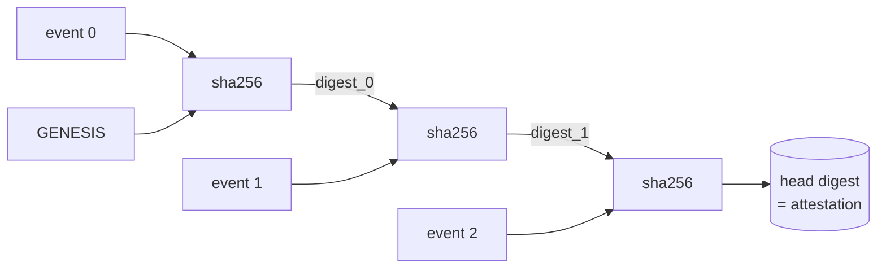

<a name="top"></a>
<div align="center">


# AUDITRAIL

### Tamper-evident audit-log aggregator with hash-chained attestation


[](https://pypi.org/project/cognis-auditrail/) [](https://github.com/cognis-digital/auditrail/actions) [](https://github.com/cognis-digital/auditrail/actions/workflows/ports.yml) [](LICENSE) [](https://github.com/cognis-digital)

*Compliance & GRC — prove your audit logs were not altered after the fact, fully self-hosted.*

</div>

```bash
pip install cognis-auditrail
auditrail verify events.jsonl     # exit 0 = intact, exit 2 = tampered
```

`auditrail` ingests audit-log events and binds them into a **SHA-256 hash chain**
(a degenerate Merkle chain). Because each link's digest is computed over *all*
prior content, any retroactive edit, deletion, insertion, or reordering of a
single event invalidates every downstream digest — and `verify` pinpoints exactly
where. It is **passive and offline**: it reads event files you give it, performs
**no network calls, no active scanning, and no log collection from remote hosts**.


<!-- cognis:example:start -->
## 🔎 Example output

Real, reproducible output from the tool — runs offline:

```console
$ auditrail-emit --version
auditrail 1.0.0
```

```console
$ auditrail-emit --help
usage: auditrail [-h] [--version] [--format {table,json}]
                 {chain,verify,attest} ...

Tamper-evident audit-log aggregator.

positional arguments:
  {chain,verify,attest}
    chain               build and print the hash chain
    verify              verify chain integrity, exit 2 on tamper
    attest              emit a compliance attestation manifest

options:
  -h, --help            show this help message and exit
  --version             show program's version number and exit
  --format {table,json}
                        output format
```

> Blocks above are real `auditrail` output — reproduce them from a clone.

**Sample `attest --format json` output** _(illustrative values — run on your own data):_

```json
{
  "tool": "auditrail",
  "version": "1.0.0",
  "source": "events.jsonl",
  "attested_at": "2026-06-23T14:05:00Z",
  "event_count": 3,
  "genesis": "0000000000000000000000000000000000000000000000000000000000000000",
  "head": "8ae3d48a5736f485bd64d7d812d5255a5548962684e79a85d05bbbfac1ea94d3",
  "first_ts": "2026-06-08T09:00:00Z",
  "last_ts": "2026-06-08T09:02:00Z",
  "distinct_actors": ["alice", "bob"],
  "intact": true,
  "break_count": 0,
  "manifest_digest": "…"
}
```

<!-- cognis:example:end -->

## Contents

- [Why auditrail?](#why) · [How it works](#how) · [Membership proofs](#proofs) · [Install](#install) · [Quick start](#quick-start) · [Worked example](#example) · [Output formats](#formats) · [Edge / air-gap](#edge) · [Language ports](#ports) · [Use from any AI stack](#ai-stack) · [Integrations](#integrations) · [Scope & safety](#scope) · [Related](#related) · [Contributing](#contributing)

<a name="why"></a>
## Why auditrail?

Compliance frameworks (SOC 2 CC7.2, PCI-DSS 10.2/10.3, ISO 27001 A.12.4) require
audit logs that are **complete and protected from modification**. A log file on
disk proves nothing on its own — anyone with write access can rewrite history.

`auditrail` gives you a single retained value — the **chain head digest** — that
acts as evidence. Recompute the chain later; if the head still matches, the log is
provably unchanged. If it doesn't, `verify` tells you the exact index and field
class that broke. No database, no server, no account, no telemetry.

<div align="right"><a href="#top">↑ back to top</a></div>

<a name="how"></a>
## How it works

```
digest_0 = sha256( GENESIS  || 0x1f || canonical_json(event_0) )
digest_1 = sha256( digest_0 || 0x1f || canonical_json(event_1) )
digest_i = sha256( digest_{i-1} || 0x1f || canonical_json(event_i) )
```

- **GENESIS** is a fixed all-zero 64-hex seed.
- **canonical_json** = sorted keys, no whitespace, stable separators — so the
  digest is byte-stable across machines and language ports.
- Every event must carry the compliance core triple **`ts` / `actor` / `action`**
  (who did what, when). Any extra fields (resource, ip, result, …) are folded into
  the hashed payload but can never shadow the core triple.
- The **head** (digest of the last link) is the chain's tamper-evident fingerprint.



<div align="right"><a href="#top">↑ back to top</a></div>

<a name="proofs"></a>
## Membership proofs (Merkle)

The hash chain proves the **whole log** is intact with one head digest, but
proving that *one specific event* is in the log means replaying every event up to
it. `auditrail` also builds a binary **Merkle tree** over the same canonical
events, giving a compact **O(log n) inclusion proof** for any single event —
without revealing or transmitting the others.

```bash
auditrail root  events.jsonl                       # the Merkle root (membership fingerprint)
auditrail prove events.jsonl --index 1 --format json > proof.json
auditrail verify-proof proof.json                  # exit 0 valid · 2 invalid
```

A verifier who holds only the trusted `root` can validate a single event: the
proof carries the leaf digest and an audit path of sibling hashes. Leaves and
internal nodes are domain-separated (`0x00` / `0x01`, RFC-6962 style) to prevent
second-preimage attacks, and odd trailing nodes are *promoted* rather than
duplicated (avoids CVE-2012-2459). See [docs/ARCHITECTURE.md](docs/ARCHITECTURE.md).

<div align="right"><a href="#top">↑ back to top</a></div>

<a name="install"></a>
## Install — every way, every platform

```bash
pip install cognis-auditrail                                          # PyPI (when published)
pip install "git+https://github.com/cognis-digital/auditrail.git"     # pip from source (works today)
pipx install "git+https://github.com/cognis-digital/auditrail.git"    # isolated CLI
uv tool install "git+https://github.com/cognis-digital/auditrail.git" # uv
docker run --rm -i ghcr.io/cognis-digital/auditrail:latest verify - < events.jsonl   # Docker
```

Pure Python standard library — no third-party runtime dependencies. Runs on
Python 3.9+ on Linux / macOS / Windows.

| Linux | macOS | Windows | Docker | Cloud |
|---|---|---|---|---|
| `scripts/setup-linux.sh` | `scripts/setup-macos.sh` | `scripts/setup-windows.ps1` | `docker run ghcr.io/cognis-digital/auditrail` | [DEPLOY.md](docs/DEPLOY.md) |

<div align="right"><a href="#top">↑ back to top</a></div>

<a name="quick-start"></a>
## Quick start

Input is a **JSON array** or **newline-delimited JSON (JSONL)**; each event needs
`ts`, `actor`, and `action`. Pass a file path, or `-`/nothing for stdin.

```bash
auditrail --version

# 1. Build and print the hash chain
auditrail chain events.jsonl

# 2. Verify integrity — exits 2 if the chain has been tampered with
auditrail verify events.jsonl

# 3. Emit a retainable attestation manifest as JSON
auditrail attest events.jsonl --format json > attestation.json

# 4. Summarize actors / actions / time span
auditrail stats events.jsonl

# 5. Merkle membership proof: prove event #1 belongs to the log, then check it
auditrail prove events.jsonl --index 1 --format json | auditrail verify-proof -
```

Full command reference, input formats, exit codes, and the Python API are in
**[docs/USAGE.md](docs/USAGE.md)**; the design is in **[docs/ARCHITECTURE.md](docs/ARCHITECTURE.md)**.

Gate CI on integrity (any tamper break exits non-zero):

```yaml
- run: pip install cognis-auditrail
- run: cat audit/events.jsonl | auditrail verify - --format json
```

<div align="right"><a href="#top">↑ back to top</a></div>

<a name="example"></a>
## Worked example

Given `events.jsonl`:

```json
[
  {"ts":"2026-06-08T09:00:00Z","actor":"alice","action":"login"},
  {"ts":"2026-06-08T09:01:00Z","actor":"alice","action":"read","resource":"r1"},
  {"ts":"2026-06-08T09:02:00Z","actor":"bob","action":"delete","resource":"r1"}
]
```

**Build the chain:**

```text
$ auditrail chain events.jsonl
IDX  DIGEST (sha256, head 12)    TS                    ACTOR / ACTION
------------------------------------------------------------------------------
  0  6ef71dd9f4ea34cc6673fbe8    2026-06-08T09:00:00Z  alice / login
  1  1a98deef3d33d1adeaeda0fd    2026-06-08T09:01:00Z  alice / read
  2  8ae3d48a5736f485bd64d7d8    2026-06-08T09:02:00Z  bob / delete

head = 8ae3d48a5736f485bd64d7d812d5255a5548962684e79a85d05bbbfac1ea94d3
```

**Verify an intact chain (exit 0):**

```text
$ auditrail verify events.jsonl
chain status: INTACT   events=3
```

**Tamper with event 1 (change `alice` → `mallory`), then verify (exit 2):**

```text
$ auditrail verify tampered.jsonl
chain status: BROKEN (1 break(s))   events=3
  ! index 1: digest mismatch (content altered) (action=read)
```

**Attestation manifest** you retain as compliance evidence:

```text
$ auditrail attest events.jsonl --format json
{
  "tool": "auditrail",
  "version": "1.0.0",
  "source": "events.jsonl",
  "attested_at": "2026-06-23T14:05:00Z",
  "event_count": 3,
  "genesis": "0000000000000000000000000000000000000000000000000000000000000000",
  "head": "8ae3d48a5736f485bd64d7d812d5255a5548962684e79a85d05bbbfac1ea94d3",
  "first_ts": "2026-06-08T09:00:00Z",
  "last_ts": "2026-06-08T09:02:00Z",
  "distinct_actors": ["alice", "bob"],
  "intact": true,
  "break_count": 0,
  "manifest_digest": "…"
}
```

<div align="right"><a href="#top">↑ back to top</a></div>

<a name="formats"></a>
## Output formats & exit codes

| Command  | `--format table` (default) | `--format json` | Exit code |
|----------|----------------------------|-----------------|-----------|
| `chain`  | indexed link table + head  | `{head, event_count, links[]}` | 0 |
| `verify` | INTACT / BROKEN summary     | `{intact, event_count, break_count, breaks[]}` | **0 intact · 2 tampered · 1 bad input** |
| `attest` | key/value manifest          | full attestation manifest (JSON) | 0 intact · 2 tampered |
| `stats`  | actor/action tallies + span | `{event_count, actors{}, actions{}, first_ts, last_ts, head}` | 0 |
| `root`   | leaf count + Merkle root    | `{kind, leaf_count, root, empty_root}` | 0 |
| `prove`  | leaf + audit path           | `{kind, index, leaf, root, leaf_count, path[]}` | 0 · 1 bad index |
| `verify-proof` | VALID / INVALID       | `{verified, index, root, leaf, leaf_count}` | **0 valid · 2 invalid · 1 malformed** |

The `verify` / `verify-proof` exit code (**2 on tamper**) is designed for CI gates and cron checks.
The JSON output composes cleanly with `jq`, SIEM forwarders, and the
[`cognis-connect`](https://github.com/cognis-digital/cognis-connect) emitter
(`auditrail attest events.jsonl --format json | auditrail-emit --to splunk`).

<div align="right"><a href="#top">↑ back to top</a></div>

<a name="edge"></a>
## Edge / air-gap

`auditrail` makes **zero network calls** and needs no services, so it runs
unchanged in fully air-gapped or classified enclaves:

- Pure standard-library Python — copy the `auditrail/` package onto the host, no
  pip index required. Or build a single static binary from any [language port](#ports).
- Generate the attestation on the air-gapped side, then carry **only the head
  digest** (64 hex chars) across the boundary as your integrity witness.
- Deterministic, byte-stable digests: the same events produce the same head on
  every OS, architecture, and language port — so an auditor on a different machine
  can independently reproduce and confirm the head.

<div align="right"><a href="#top">↑ back to top</a></div>

<a name="ports"></a>
## Language ports

The core hash-chain surface (`chain` / `verify` / `attest`) is ported across
languages. **Every port reproduces the identical reference head**
`8ae3d48a…ea94d3` over the worked-example events — verified in CI by
[`.github/workflows/ports.yml`](.github/workflows/ports.yml).

| Language | Path | Run | Smoke test |
|---|---|---|---|
| Python (reference) | [`auditrail/`](auditrail/) | `auditrail verify events.jsonl` | `python -m pytest` |
| JavaScript / Node  | [`ports/javascript/`](ports/javascript/) | `node ports/javascript/index.js verify events.jsonl` | `node ports/javascript/test.js` |
| Go                 | [`ports/go/`](ports/go/) | `cd ports/go && go run . verify ../../events.jsonl` | `go test ./...` |
| Rust               | [`ports/rust/`](ports/rust/) | `cd ports/rust && cargo run -- verify ../../events.jsonl` | `cargo test` |
| POSIX shell        | [`ports/shell/`](ports/shell/) | `sh ports/shell/auditrail.sh verify events.jsonl` | `sh ports/shell/test.sh` |

The Rust and shell ports implement SHA-256 / canonical JSON with **zero external
dependencies**, so they build and test offline with stock toolchains.

<div align="right"><a href="#top">↑ back to top</a></div>

<a name="ai-stack"></a>
## Use it from any AI stack

- **MCP server** — `auditrail mcp` (Claude Desktop, Cursor, Cognis.Studio, [uncensored-fleet](https://github.com/cognis-digital/uncensored-fleet))
- **JSON in/out** — pipe `auditrail attest events.jsonl --format json` into any agent or LLM
- **LangChain · CrewAI · AutoGen · LlamaIndex** — wrap the CLI/JSON as a tool in one line
- **CI / scripts** — exit codes (2 = tampered) for non-AI pipelines

<div align="right"><a href="#top">↑ back to top</a></div>

<a name="integrations"></a>
## Integrations

JSON for anything, an **MCP server** (`auditrail mcp`) for AI agents, and a native
[`cognis-connect`](https://github.com/cognis-digital/cognis-connect) emitter that
forwards attestations to STIX/TAXII, MISP, Sigma, Splunk, Elastic, Slack/Discord,
or a webhook. See [`docs/INTEGRATIONS.md`](docs/INTEGRATIONS.md) and [INTEROP.md](INTEROP.md).

<div align="right"><a href="#top">↑ back to top</a></div>

<a name="scope"></a>
## Scope & safety

- **Defensive / compliance use only.** `auditrail` verifies the integrity of audit
  logs you already own. It does **not** collect logs from remote hosts, does **not**
  perform any network or active scanning, and ships no exploit functionality.
- **Passive & offline by default.** All processing happens locally on files you
  provide; nothing is transmitted.
- **Authorization.** Use only on logs you are authorized to handle. The attestation
  is an integrity witness, not a legal signature — pair it with your organization's
  evidence-retention and chain-of-custody procedures.
- Tests hit only local fixtures; no test or example reaches the network.

<div align="right"><a href="#top">↑ back to top</a></div>

<a name="related"></a>
## Related Cognis tools

- [`soc2box`](https://github.com/cognis-digital/soc2box) — SOC 2 evidence collector and control tracker
- [`gdprkit`](https://github.com/cognis-digital/gdprkit) — GDPR/CCPA DSAR, RoPA, and cookie-consent toolkit
- [`policyforge`](https://github.com/cognis-digital/policyforge) — auto-generate security policies from a short questionnaire
- [`vendorvet`](https://github.com/cognis-digital/vendorvet) — third-party / vendor risk questionnaires with SBOM cross-ref
- [`frameworkmap`](https://github.com/cognis-digital/frameworkmap) — crosswalk controls across NIST, ISO 27001, SOC 2, CMMC, PCI
- [`cognis-connect`](https://github.com/cognis-digital/cognis-connect) — forward findings/attestations to STIX/MISP/Sigma/SIEM/chat

**Explore the suite →** [🗂️ all 170+ tools](https://github.com/cognis-digital/cognis-neural-suite) · [⭐ awesome-cognis](https://github.com/cognis-digital/awesome-cognis) · [🤖 uncensored-fleet](https://github.com/cognis-digital/uncensored-fleet)

<div align="right"><a href="#top">↑ back to top</a></div>

<a name="contributing"></a>
## Contributing

PRs, new language ports, and demo scenarios are welcome under the collaboration-pull
model — see [CONTRIBUTING.md](CONTRIBUTING.md) and [SECURITY.md](SECURITY.md).

> ### ⭐ If `auditrail` saved you time, **star it** — it genuinely helps others find it.

## Interoperability

`auditrail` composes with the Cognis suite — JSON in/out and a shared
OpenAI-compatible `/v1` backbone. See **[INTEROP.md](INTEROP.md)** for the suite
map, composition patterns, and reference stacks.

## License

Source-available under the **Cognis Open Collaboration License (COCL) v1.0** — free
for personal, internal-evaluation, research, and educational use; **commercial /
production use requires a license** (licensing@cognis.digital). See [LICENSE](LICENSE).

---

<div align="center"><sub><b><a href="https://cognis.digital">Cognis Digital</a></b> · one of 170+ tools in the <a href="https://github.com/cognis-digital/cognis-neural-suite">Cognis Neural Suite</a> · <i>Making Tomorrow Better Today</i></sub></div>
